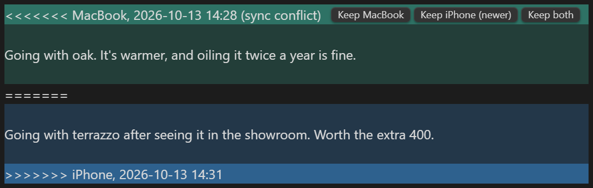

# Easy Git Sync

Sync your Obsidian vault with a GitHub repository, on desktop and mobile.

<!-- demo video -->

- Runs entirely inside Obsidian, phones included: no git or other app required.
- Edits from different devices merge line by line. Where two touch the same line, both versions stay in the note, one tap to keep either.
- Nothing is lost: an edit beats a deletion, and every version stays in the history.
- An ordinary git repository, one commit per sync, named after the device and what changed.

## Setup

1. Install Easy Git Sync from Community plugins and open its settings.
2. Press **Create token on GitHub**. The form opens filled in: under *Repository access*, pick your vault's repository (an empty private one is fine), then generate the token and copy it.
3. Paste it into **Access token**, press **Choose** to pick the repository, then **Start syncing**. You see what will be uploaded, downloaded and merged before anything happens.

Do the same on your other devices. The token is kept in Obsidian's keychain on each device and never synced.

If the vault and the repository both already have notes, you choose: merge them, make the vault a copy of the repository, or the other way round. Files that get replaced go to Obsidian's trash first.

Turn the Git plugin off on devices that use Easy Git Sync. It waits until it is.

## Conflicts

The block is ordinary git conflict markers, so any editor or git tool can read it too. *Resolve all sync conflicts with the newer version* settles every block at once.

## Privacy

Easy Git Sync needs a GitHub account and connects only to GitHub: `api.github.com`, and `codeload.github.com` for the first download of a large repository. It sends your vault to the repository you pick and nowhere else, and has no telemetry.

On desktop, if the vault folder is itself a clone of the same repository, it runs `git` in that folder to keep the clone up to date.

## Limits

- GitHub only, for now. Other hosts may follow if there is demand.
- Files over 100 MB are not synced, since GitHub refuses them.
- Two files whose names differ only in capital letters cannot both exist on most devices; the second is skipped with a notice.
