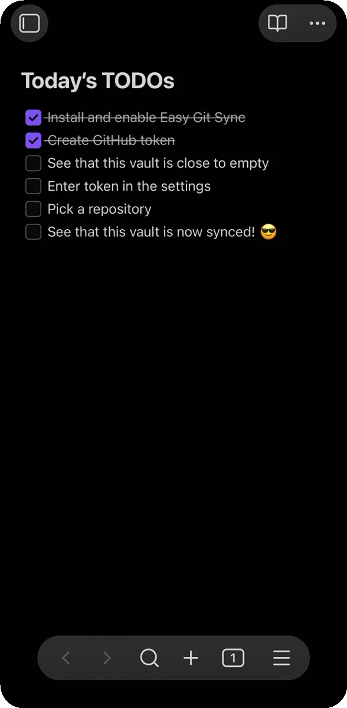
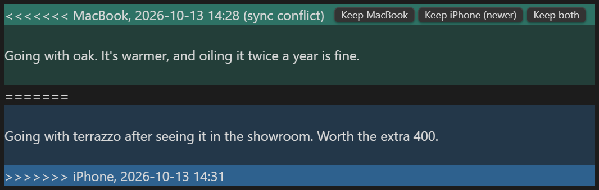

# Easy Git Sync

Sync your Obsidian vault with a git repository on GitHub, GitLab, Bitbucket, Codeberg or your own server, on desktop and mobile.

- Runs entirely inside Obsidian, phones included: no git or other app required.
- Edits from different devices merge line by line. Where two touch the same line, both versions stay in the note, one tap to keep either.
- Nothing is lost: an edit beats a deletion, and every version stays in the history.
- An ordinary git repository, one commit per sync, named after the device and what changed.

Set up in under a minute:

  

## Setup

1. Install [Easy Git Sync](https://community.obsidian.md/plugins/easy-git-sync) from Community plugins and open its settings.
2. Pick your **Provider**: GitHub, GitLab, Bitbucket, Forgejo / Gitea (Codeberg or your own server), or any other git server over HTTPS.
3. Press **Create token on GitHub** (or GitLab, and so on). Where the host allows it, the form opens filled in. On GitHub, under *Repository access*, pick your vault's repository (an empty private one is fine), then generate the token and copy it.
4. Paste it into **Access token**, press **Choose** to pick the repository, then **Start syncing**. You see what will be uploaded, downloaded and merged before anything happens.

For any other git server, enter the repository's HTTPS address with a username and password or token instead.

Do the same on your other devices. The token is kept in Obsidian's keychain on each device and never synced.

If the vault and the repository both already have notes, you choose: merge them, make the vault a copy of the repository, or the other way round. Files that get replaced go to Obsidian's trash first.

Turn the Git plugin off on devices that use Easy Git Sync. It waits until it is.

## Conflicts

The block is ordinary git conflict markers, so any editor or git tool can read it too. *Resolve all sync conflicts with the newer version* settles every block at once.

## Privacy

Easy Git Sync connects only to the host you pick: for GitHub `api.github.com`, and `codeload.github.com` for the first download of a large repository; for GitLab, Forgejo and Gitea the server you enter; for Bitbucket `api.bitbucket.org` and `bitbucket.org`; for another git server the address you enter. The Bitbucket token button opens Atlassian's account page. It sends your vault to the repository you pick and nowhere else, and has no telemetry.

On desktop, if the vault folder is itself a clone of the same repository, it runs `git` in that folder to keep the clone up to date.

## Limits

- Git over HTTPS only: phones cannot use SSH.
- Files over 100 MB are not synced, since GitHub and most hosts refuse them.
- On a server that only sends whole commits (a plain `git http-backend` without protocol v2), first syncs do not look through the history for older copies of a note, and a clash can download more than the changed files.
- Two files whose names differ only in capital letters cannot both exist on most devices; the second is skipped with a notice.
